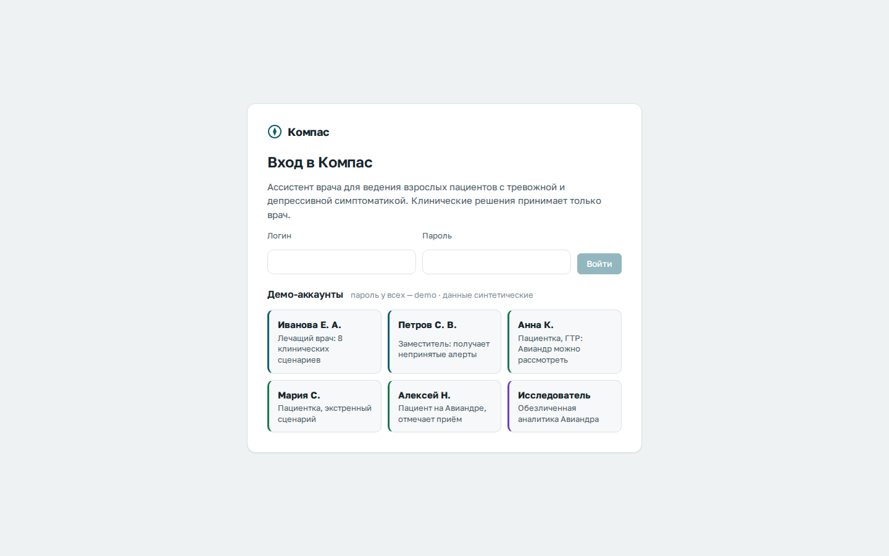
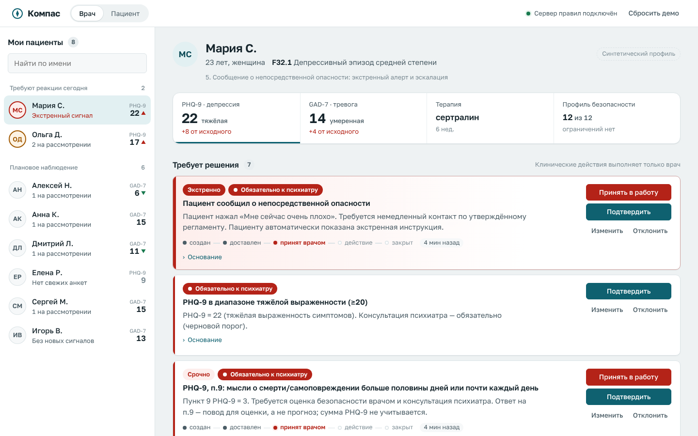
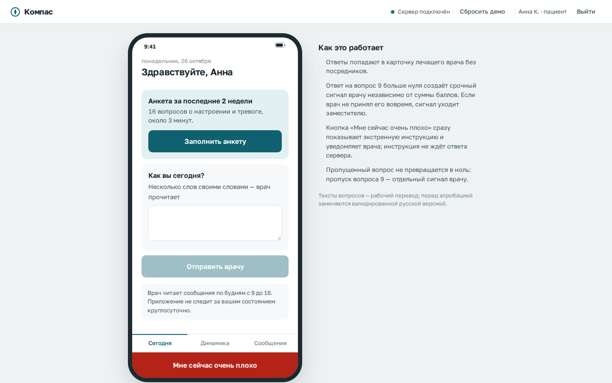
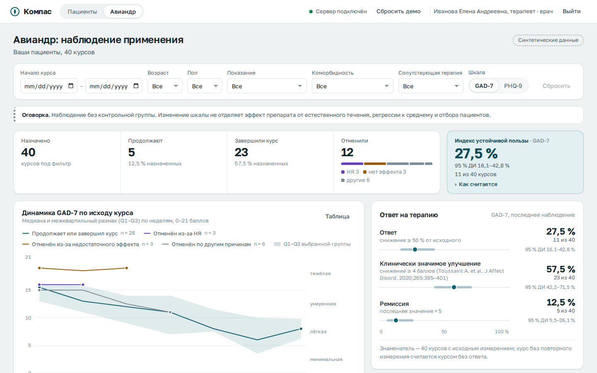
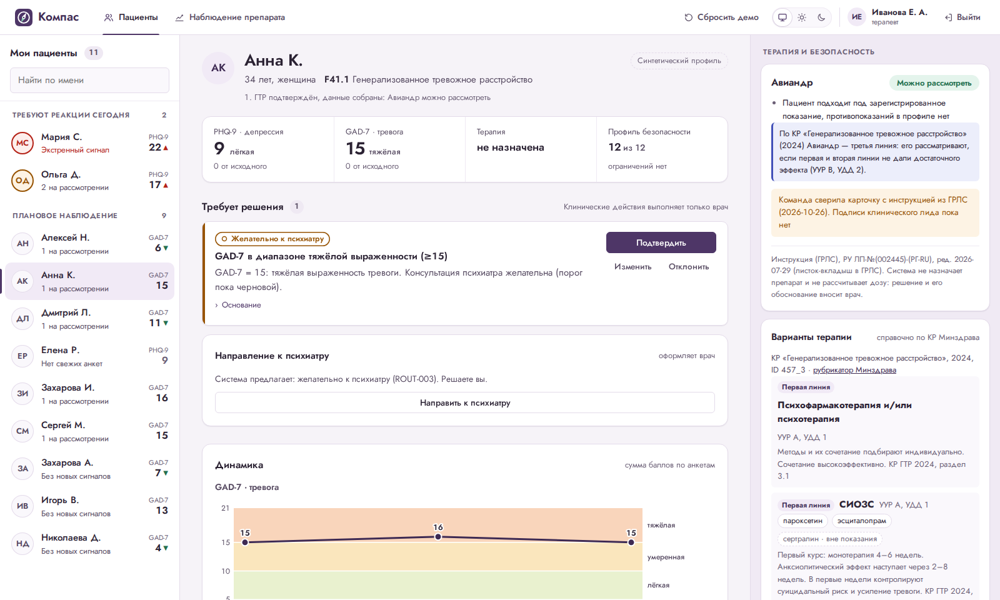
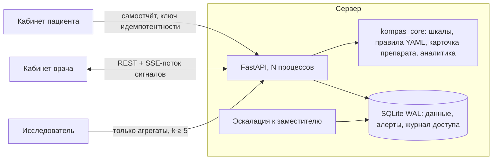

# Компас — цифровой ассистент врача

Система поддержки решений для ведения взрослых пациентов с тревожной и депрессивной симптоматикой.
Три роли — **врач**, **пациент**, **исследователь**. Валидированные шкалы, динамика, проверка
применимости препарата по инструкции из ГРЛС, алертинг с эскалацией, маршрутизация к психиатру
«обязательно / желательно», переписка, приверженность и **наблюдение применения Авиандра** на данных,
которые вводят врач и пациент. Все клинические действия выполняет только врач. Все данные синтетические.

| Вход по ролям | Живой алерт врачу |
|---|---|
|  |  |
| **Кабинет пациента** | **Авиандр: наблюдение применения** |
|  |  |
| **Проверка препарата и справка по КР** | |
|  | |

Материалы предзащиты команды «Мозгобойня»: [демо-видео, 2:11](docs/pitch/kompas-demo.mp4),
[презентация](docs/pitch/kompas-deck.pdf), [постер A1](docs/pitch/kompas-poster-a1.pdf).

## Запуск за минуту

```bash
pip install -r requirements.txt
cd frontend && npm ci && npm run build && cd ..
python -m server                      # → http://localhost:8000
```

При первом запуске БД (`data/kompas.db`) заполняется демо-данными. Можно и через Docker:
`docker build -t kompas . && docker run -p 8000:8000 kompas`.

| Демо-аккаунт (пароль `demo`) | Роль | Что показать |
|---|---|---|
| `ivanova` | лечащий врач | триаж пациентов, алерты, решения, аналитика Авиандра по своим пациентам |
| `petrov` | заместитель | получает алерт, если лечащий врач не принял его за `KOMPAS_ESCALATE_AFTER_S` (60 с) |
| `anna`, `maria`, `alexey` … | пациенты | анкета PHQ-9 + GAD-7, дневник, отметка приёма, сообщения, кнопка «Мне сейчас очень плохо» |
| `researcher` | исследователь | только обезличенная аналитика, группы меньше 5 человек скрыты |

Врача и пациента удобно открыть в двух вкладках: вход у каждой вкладки свой.

## Задачи ТЗ → где в прототипе

| Задача инструмента | Реализация |
|---|---|
| 1. Стандартизированная оценка | PHQ-9 и GAD-7 **дословно в валидированных русских версиях** (Золотарева 2023) с паспортами (`kompas_core/scales/*.yaml`): расчёт, пропуски, пороги; п.9 никогда не восстанавливается |
| 2. Сведения о терапии | **Справка по действующим КР Минздрава 2024** (ГТР ID 457_3, депрессия ID 301_3): линии терапии, УУР/УДД, психотерапия, отметка «есть ли показание в инструкции». Карточка Авиандра **сверена с ГРЛС**: «можно рассмотреть / не подходит / недостаточно данных»; по КР ГТР Авиандр — третья линия. Рекомендации «назначить» нет |
| 3. Риски и нежелательные явления | Профиль безопасности с трёхзначной логикой (неизвестно ≠ нет); **загрузка выписки** — факты извлекаются с цитатой и попадают в профиль только после подтверждения врачом; дневник НЯ, серьёзное НЯ → срочный алерт |
| 4. Мониторинг динамики | MCID, надёжное изменение, ответ, ремиссия, полнота наблюдения; пропуски не считаются стабильностью |
| 5. Интерфейс пациента | Анкета (раз в 2 недели — окно шкалы), дневник, отметка приёма, своя динамика, экстренная инструкция без ожидания сервера |
| 6. Каналы коммуникации | Переписка врач ↔ пациент со статусами «отправлено / доставлено / прочитано»; сигналы — отдельным контуром (SSE) |
| 7. Приверженность | Ежедневные отметки «принял / пропустил»; подтверждённые, пропуски и дни без отметки считаются отдельно |
| 8. Направление к психиатру | Две оси: «обязательно / желательно» и «экстренно / срочно / планово», визуально различимы; врач **оформляет направление** (статусы: оформлено → записан → консультация состоялась), пациент видит рекомендацию |
| **Сверх ТЗ** | **Наблюдение применения Авиандра**: KPI курсов, медианная динамика по исходу (продолжил / отменён из-за НЯ / из-за неэффективности), причины отмен, приверженность, НЯ, контекст выборки и **индекс устойчивой пользы** с 95 % ДИ |

## Обязательные условия ТЗ

| Условие | Как выполнено |
|---|---|
| Роли с раздельными правами | Вход по токену; права проверяет сервер: пациент — только своя карточка, врач — свои пациенты, исследователь — только агрегаты. Матрица из 32 проверок «роль × действие × свой/чужой» и проверка обязательного входа на 17 путях API — 0 несанкционированных доступов |
| Связь «врач — пациент» | Данные пациента попадают в карточку его лечащего врача без посредников; заместитель получает доступ только к пациенту эскалированного сигнала |
| Клинические действия — только врач | Система не назначает, не меняет и не отменяет терапию; каждое предложение подтверждается, меняется или отклоняется (с причиной) и пишется в журнал с версией правила |
| Сценарии с Авиандром | 8 сценариев (`synthetic/demo_patients.py`): можно рассмотреть, противопоказание, нет показания, недостаточно данных, экстренный случай, НЯ, пропуски, ответ на терапию |
| Алертинг | Алерт создаётся в одной транзакции с данными, доставляется врачу сразу (SSE), имеет жизненный цикл (создан → доставлен → принят → закрыт) и эскалируется заместителю |
| Выделение сигналов | «Обязательно» — красный, «желательно» — янтарный, безопасность терапии — фиолетовый; экстренные сверху |
| Только препараты РФ в рамках инструкции | Источник — листок-вкладыш из ГРЛС (РУ ЛП-№(002445)-(РГ-RU), файл 29.07.2026); off-label система не предлагает |
| Клинические рекомендации, шкалы, источники | Каждое правило несёт источник и версию; паспорта шкал — с русскими валидациями (Золотарева 2023); см. [METHODOLOGY](docs/METHODOLOGY.md) |
| Конфиденциальность и закон | **Согласие пациента** с версией текста до передачи данных (152-ФЗ); экстренная кнопка работает и без согласия (защита жизни). Журнал доступа, k-анонимность для исследователя, синтетические данные |

## Метрики

| Метрика ТЗ | Результат | Отчёт |
|---|---|---|
| Корректность шкал и правил | 325 автотестов ядра и сервера, 13 — логики интерфейса, 31 сквозной сценарий в браузере; 0 падений | `pytest`, `pytest e2e`, `npm test` |
| Эргономика (действия и отклик) | экстренный сигнал: на экране врача за 71 мс, обработка — 3 действия; направление — 3; выписка → статус препарата — 9; анкета пациента — 19 (16 ответов); отклик интерфейса ≤ 0,8 с | [ergonomics](evaluation/results/ergonomics.md) |
| Извлечение из документов (3 шаблона, отложенный набор n=300) | F1: препараты 0,96, дозы 0,97, диагнозы 0,81, аллергии 0,63. **Ни разу «нет противопоказания» при его наличии**: пропущенное остаётся «неизвестно», и система отвечает «недостаточно данных». На наборе разработки F1 = 1,00 — разница показывает зависимость от формулировок | [extraction_eval](evaluation/results/extraction_eval.md) |
| Шкала и п.9 на реальных ответах (открытый датасет Kaggle, 185 человек, CC0) | α Кронбаха 0,85 (русская версия: 0,89); сумма PHQ-9 и среднее настроение за 14 дней: ρ = −0,68; у 6 человек мысли о самоповреждении при сумме < 10, порог по сумме их бы пропустил. Выборка не клиническая | [real_phq9](evaluation/results/real_phq9.md) |
| Точность алертинга (синтетика n=1000) | сигнал безопасности: чувствительность 0,89 [0,84; 0,93], специфичность 0,93; «обязательно к психиатру»: 0,96 / 0,96 | [alert_eval](evaluation/results/alert_eval.md) |
| Время доставки алерта | сохранение → алерт **3 мс** (p50); отправка пациентом → у врача на экране **10–14 мс** p50, 64 мс p95; потерь 0 из 200 | [alert_latency](evaluation/results/alert_latency.md) |
| Нагрузка | 100 сессий, 2784 запроса, **0 ошибок**; p95 самоотчёта 238 мс, карточки 921 мс, аналитики 1,8 с (цель ≤ 2–3 с) | [load_test](evaluation/results/load_test.md) |
| Отказоустойчивость | `kill -9` посреди потока самоотчётов, 5 прогонов: **0 потерь** из 387 подтверждённых, 0 дублей при повторе, недоставленные алерты пришли после рестарта, восстановление ≤ 2,6 с | [recovery](evaluation/results/recovery.md) |
| Быстродействие правил | расчёт всех правил и проверки препарата для пациента — 0,4 мс | — |

## Архитектура



* **Ядро `kompas_core`** — чистая библиотека без сети и БД. Шкалы, правила алертинга и маршрутизации,
  препараты — в YAML: их можно добавлять и менять без изменения ядра.
* **Сервер `server/`** хранит данные, проверяет права, создаёт алерты в той же транзакции, что и данные
  пациента (с fsync), и доставляет их врачу через SSE. Недоставленный алерт берётся из БД, поэтому
  переживает разрыв связи, перезапуск и работу в нескольких процессах.
* **Аналитика** строится из тех же таблиц, что заполняют врач и пациент: каждый новый самоотчёт и
  отметка приёма сразу попадают в наблюдение применения препарата.

Подробности: [контракт данных](docs/API_CONTRACT.md), [методология и источники](docs/METHODOLOGY.md).

## Структура

```
kompas_core/   ядро: шкалы, динамика, правила (YAML), препарат, аналитика
server/        FastAPI + SQLite: роли, алерты, сообщения, приём, аналитика, раздача интерфейса
frontend/      React + TypeScript: вход, кабинеты врача и пациента, аналитика
synthetic/     сценарии ТЗ, синтетическая когорта курсов Авиандра, генератор для оценки алертинга
evaluation/    метрики: алертинг, нагрузка, доставка алерта, восстановление → evaluation/results/
tests/, e2e/   автотесты ядра и сервера; сквозные сценарии в браузере (Playwright)
```

## Тесты

```bash
python -m pytest -q                     # ядро и сервер
pip install playwright && playwright install chromium
python -m pytest e2e -q                 # сквозные сценарии через интерфейс
cd frontend && npm test                 # логика экрана аналитики
```

## Ограничения

Прототип для демонстрации на синтетических данных. До реальных пациентов нужны утверждение правил и
порогов клиническим лидом, подпись сверки карточки препарата, дословные валидированные русские тексты
анкет, правовая оценка (152-ФЗ, 323-ФЗ, статус медицинского изделия), MFA врачей и регламент
реагирования на алерты. Наблюдение применения препарата — описание без контрольной группы, а не
доказательство эффективности.
